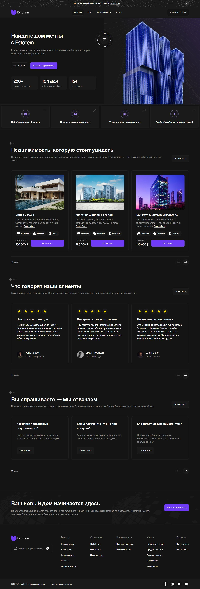
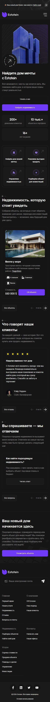
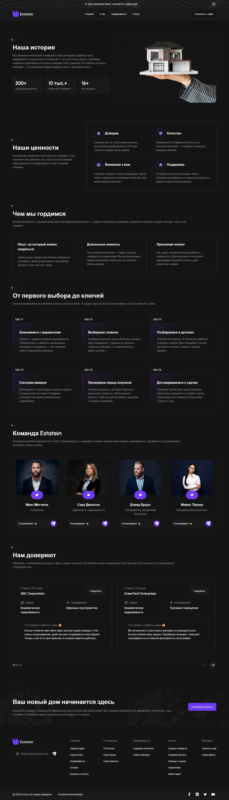
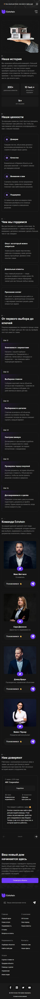
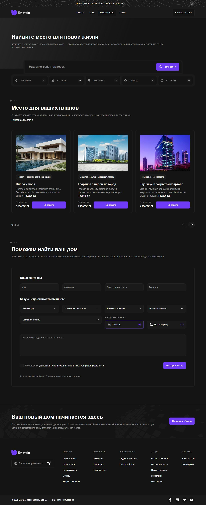
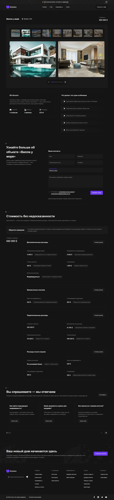

# Estatein

Многостраничный сайт агентства недвижимости на React, Vite и SCSS. Вёрстка по макету Figma с русскими текстами, каталогом объектов, фотогалереями и адаптивом от 320 px.

## Ссылки

Сайт опубликован на GitHub Pages: [https://aaapa.github.io/estatein/](https://aaapa.github.io/estatein/).

Исходный код: [aaapa/estatein](https://github.com/aaapa/estatein).

- [Главная](https://aaapa.github.io/estatein/)
- [О компании](https://aaapa.github.io/estatein/about/)
- [Недвижимость](https://aaapa.github.io/estatein/apartments/)
- [Страница объекта — вилла у моря](https://aaapa.github.io/estatein/apartments/seaside-villa/)
- [Услуги](https://aaapa.github.io/estatein/services/)
- [Контакты](https://aaapa.github.io/estatein/contacts/)
- [Превью сайта](public/site-preview.png)
- [Макет в Figma](https://www.figma.com/design/9JPq2RNUZMUNALrnlUd3sy/Real-Estate-Business-Website-UI-Template---Dark-Theme-%7C-Produce-UI--Community---Copy-?node-id=60-3106)

## Стек

| Технология         | Для чего используется                                    |
| ------------------ | -------------------------------------------------------- |
| React + JavaScript | Компоненты интерфейса, состояние и обработка действий    |
| Vite               | Локальный сервер и сборка проекта                        |
| React Router       | Навигация между страницами и параметры поиска            |
| HTML + SCSS        | Семантическая разметка, адаптив и стили по БЭМ           |
| SimpleBar          | Прокрутка страницы, слайдеров, списков и текстовых полей |
| Tippy.js           | Подсказки для кнопок с иконками                          |
| IMask              | Маски и ограничения ввода в формах                       |
| clsx               | Условные классы компонентов                              |
| gh-pages           | Публикация сборки в ветку GitHub Pages                   |
| Prettier           | Форматирование исходного кода                            |

Фотографии хранятся в WebP, иконки — в общем SVG-спрайте. Шрифт Urbanist подключён локально в WOFF2 с запасным `sans-serif`. Сборка сохраняет HTML всех 11 маршрутов: пяти общих страниц и шести объектов недвижимости. После загрузки React подключает обработчики к готовой разметке.

## Возможности

- Адаптивная вёрстка от 320 px и мобильное меню с анимацией.
- Каталог с поиском и фильтрами по городу, типу объекта, стоимости, площади и году постройки. Применённые фильтры сохраняются в адресной строке.
- Страницы объектов с фотографиями, характеристиками и подробной стоимостью покупки.
- Слайдеры с кнопками, счётчиками и перетаскиванием мышью или касанием.
- Кастомные поля, селекты, чекбоксы, каретка и проверка заполнения форм.
- Управление с клавиатуры, видимые состояния фокуса и текстовые подписи у кнопок с иконками.
- Метаинформация для каждой страницы, Open Graph, Twitter Card, фавиконки и веб-манифест.

Данные объектов, цены и отзывы демонстрационные. Формы проверяют ввод, но отправка заявок и подписок на сервер пока не подключена.

## Скриншоты

Полные страницы от шапки до подвала, без обрезки и уменьшения исходных файлов. Ширина версии для компьютера — 1440 px, мобильной — 390 px. Изображения можно открыть отдельно в исходном размере.

### Главная



<details>
<summary>Мобильная версия — полная страница</summary>



</details>

### О компании



<details>
<summary>Мобильная версия — полная страница</summary>



</details>

### Недвижимость



<details>
<summary>Мобильная версия — полная страница</summary>


</details>

### Страница объекта



<details>
<summary>Мобильная версия — полная страница</summary>


</details>

### Услуги


<details>
<summary>Мобильная версия — полная страница</summary>


</details>

### Контакты


<details>
<summary>Мобильная версия — полная страница</summary>


</details>

## Мета

- Заголовки страниц: `Estatein | Название страницы`, например `Estatein | Контакты`.
- Отдельные description, Open Graph и Twitter Card для каждой страницы.
- Превью: [`public/site-preview.png`](public/site-preview.png), PNG, 1200 × 630 px. Логотип и название расположены в одну строку по центру.
- Theme color: `#141414`.
- Фавиконки: ICO, SVG и PNG, Apple Touch Icon и иконки веб-манифеста.
- Локальные шрифты и изображения без внешних запросов к сервисам шрифтов.

Адрес публикации задан в `homepage` файла `package.json`: `https://aaapa.github.io/estatein/`. Сборка учитывает подпапку `/estatein/` в маршрутах, путях к файлам, canonical, `og:url`, превью и веб-манифесте.

Карта сайта: [`public/sitemap.xml`](public/sitemap.xml) — все 11 страниц с `lastmod`, `changefreq` и `priority`. В [`public/robots.txt`](public/robots.txt) указана ссылка на опубликованную карту сайта. При добавлении страницы обновите список маршрутов и карту сайта.

Для другого хостинга скопируйте `.env.example` в `.env.local` и задайте `VITE_SITE_URL` — полный HTTPS-адрес, включая подпапку при её наличии. Локальные файлы окружения исключены из Git.

## Команды

Понадобятся Node.js 22.12 или новее и npm.

Установка зависимостей и запуск:

```bash
npm ci
npm run dev
```

Локальный адрес: [http://127.0.0.1:5173/](http://127.0.0.1:5173/). Если порт занят, Vite выведет другой адрес в терминале.

Сборка и просмотр готового сайта:

```bash
npm run build
npm run preview
```

Команда сборки создаёт `dist` с файлами `assets/main.js` и `assets/main.css`. Подключение `main.js` автоматически переносится после `</body>`. Предварительный рендеринг 11 страниц выполняется плагином в `vite.config.js`. Для размещения нужен хостинг статических файлов с поддержкой `index.html` во вложенных папках. Команда `preview` запускает локальный просмотр сборки, по умолчанию на порту 4173.

## Публикация

После изменений отправьте исходники в ветку `main`, затем выполните:

```bash
npm run deploy
```

Сценарий `predeploy` автоматически собирает сайт. Библиотека `gh-pages` отправляет содержимое `dist` в ветку `gh-pages` и создаёт `.nojekyll`. GitHub Pages публикует эту ветку из корня. Доступ к репозиторию выполняется через настроенную авторизацию Git; токены в проекте не хранятся.

## Структура проекта

```text
public/
  favicons/       Фавиконки и иконки манифеста
  fonts/          Локальные шрифты
  icons/          Общий SVG-спрайт
  images/         Изображения по блокам
  screenshots/    Полноразмерные скриншоты страниц
  site-preview.png
  sitemap.xml     Карта сайта
  robots.txt      Правила индексации
src/
  app/            Запуск, маршрутизация и глобальные стили
  pages/          Сборка страниц
  widgets/        Самостоятельные блоки страниц
  features/       Формы и пользовательские действия
  entities/       Карточки и данные объектов, отзывов и вопросов
  shared/         Общие компоненты, функции и SCSS-миксины
```
